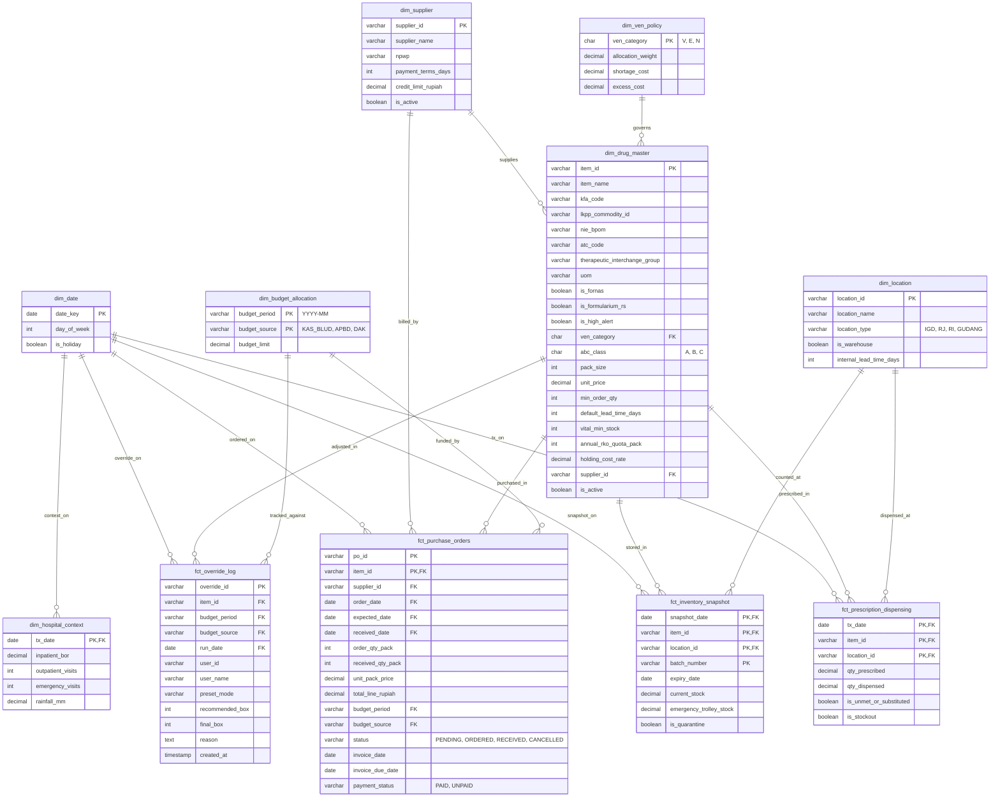

# ERD Datamart Sediantara

Entity Relationship Diagram (ERD) dan Kontrak Skema Analitik untuk Replika Baca (*Read-Replica*) SIMRS & Data Mart Pengadaan Obat Sediantara.

---

### Aturan Relasi Data
1. **Multi-Source Funding Integrity:** `dim_budget_allocation` menggunakan composite primary key `(budget_period, budget_source)` agar pencatatan kas operasional BLUD, subsidi APBD, dan DAK dalam bulan yang sama tidak bertabrakan.
2. **AP Aging & Supplier Lock:** `fct_purchase_orders` menyimpan `invoice_due_date` dan `payment_status` yang berelasi dengan `dim_supplier.supplier_id` untuk menghitung umur utang invoice terlama ($\ge 60$ hari) secara otomatis.
3. **Audit Akuntabilitas BPK/Itjen:** Setiap penyesuaian (*override*) rekomendasi sistem wajib mencatat identitas apoteker (`user_id`, `user_name`), mode preset yang digunakan, dan stempel waktu UTC (`created_at`) di `fct_override_log`.
