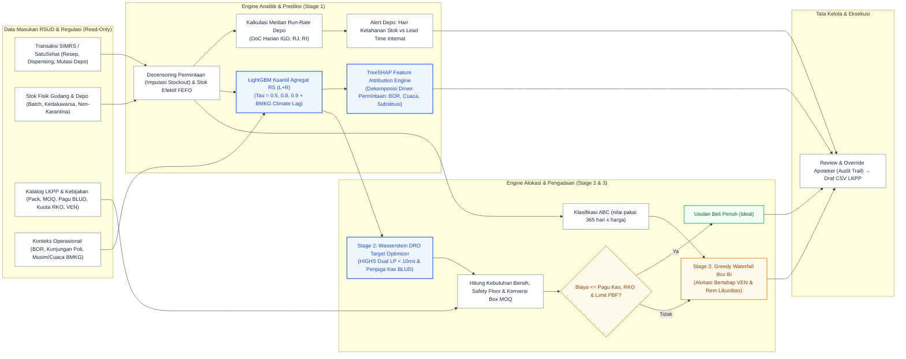

# Sediantara: Sistem Pengadaan Obat RSUD Berbasis Integrasi ABC–VEN, Machine Learning & Batas Kas BLUD

> **Sediantara**: Sistem peramalan kebutuhan dan optimasi alokasi pengadaan obat RSUD berbasis integrasi **Matriks ABC–VEN**, **Machine Learning Quantile Forecasting (LightGBM)**, **Wasserstein Distributionally Robust Optimization (HiGHS Dual LP)** [12][18], serta **Dual-Constraint Anggaran (Kas BLUD & Kuota RKO)**.

---

### Tim Pelaksana & Struktur Peran
Pengembangan dan validasi ilmiah Sediantara dilakukan secara kolaboratif lintas disiplin:
1. **Dr. Karlisa Priandana, S.T., M.Eng** — Ketua Tim (IPB University; Validasi Ilmiah & Arah Metodologi Penelitian).
2. **Jeremy Tjahjana** — Koordinator Produk, Bisnis & Sistem Informasi (Kebutuhan Pengguna, Alur Kerja Farmasi, Pengujian Kegunaan).
3. **Julius Calvin Kurniadi** — Koordinator Teknis (Arsitektur Web, Standar Pengembangan, Integrasi Modul).
4. **Gilang Muhamad Widiagung** — Koordinator AI & Model Machine Learning (Feature Engineering, Peramalan Deret Waktu, Validasi Bebas Data Leakage).
5. **Ilham Edgar Maulana Goesasi** — Koordinator Integrasi & UI/UX (Desain Antarmuka, Menghubungkan Model ke Mesin Rekomendasi, Ekspor Draf LKPP).
6. **Benedictus Tjahjana** — Masukan Industri & Hilirisasi (RS Melania Bogor; Kelayakan Logistik Rumah Sakit & Risiko Implementasi Pengadaan).

> **Core Value Proposition:** Menghubungkan prediksi kebutuhan obat berbasis kuantil (LightGBM) dengan optimasi alokasi berpenjaga anggaran kas serta aturan prioritas klinis **Matriks ABC–VEN** untuk **mengantisipasi lonjakan wabah musiman BMKG tanpa memicu pembekuan kredit distributor PBF**, menekan risiko kekosongan obat Vital dan Esensial, serta memberi peringatan dini di depo sebelum resep obat kosong, tanpa menumpuk modal mati di instalasi farmasi RSUD.

---

## 1. Project Snapshot & Scope Guardrails

| Atribut | Definisi / Spesifikasi |
| :--- | :--- |
| **Kategori & Track** | Digitalisasi AI Bidang Kesehatan (Hackathon DeepTech 2026) [1] |
| **Target Pengguna** | Tim Farmasi Perencana & Kepala Instalasi Farmasi RSUD (Kelas B & C) |
| **Pendekatan Sistem** | **Decision-Support System (Human-in-the-Loop):** tiap prediksi disertai faktor pendorong, pembanding baseline, dan dapat di-*override* apoteker dengan log alasan |
| **Komposisi Tim** | Multi-disiplin: profesional industri, akademisi/dosen periset, dan 4 *core software & data engineers* (kombinasi rigor ilmiah & delivery siap pakai di RSUD) |
| **Komputasi & Runtime** | Tanpa GPU: GBDT + aturan logika di CPU standar (target: < 3 detik untuk 50 SKU). Arsitektur produksi: Backend REST API FastAPI (Python) decoupled dengan Webapp Frontend Next.js (App Router + Tailwind CSS + Recharts). |
| **Strategi Presentasi & Pitching** | Demo berfokus pada **alur operasional nyata**: Alert Depo $\rightarrow$ Simulasi Defekta Kas Ketat (§6) $\rightarrow$ Draf CSV LKPP. Desain antarmuka mengacu pada standar visual kelas dunia (Rxflow Dashboard) tanpa fitur kosmetik chatbot LLM teks bebas. |
| **Output Utama** | Alert hari ketahanan stok depo (diperbarui harian dari snapshot stok) + Draf Usulan Pembelian / Defekta untuk Pejabat Pengadaan (PP) & PPK via e-Purchasing LKPP (ekspor CSV) [9] |

### 1.1 Tata Kelola Klinis & Otoritas Keputusan di RSUD

1. **Komite / Tim Farmasi dan Terapi (KFT):** Menetapkan kebijakan makro: ambang fraktil CSL target per kelas VEN ($\tau_V, \tau_E, \tau_N$), katalog padanan substitusi legal yang terkunci pada Formularium RS & Formularium Nasional (Fornas), serta stok minimum darurat troli IGD/ICU (`vital_min_stock`) [7].
2. **Apoteker Perencana / Kepala Instalasi Farmasi:** Mengkaji draf usulan rekomendasi AI, melakukan penyesuaian (*override*) berdasar pertimbangan klinis/musiman dengan kewajiban mengisi log alasan pada `fct_override_log`, dan mengesahkan defekta pengadaan.
3. **Pejabat Pengadaan (PP) & Pejabat Pembuat Komitmen (PPK):** Mengeksekusi Draf Usulan Pembelian menjadi paket pemesanan resmi (*Purchase Order*) melalui transaksi *e-Purchasing* e-Katalog INAPROC LKPP (Perpres 16/2018 jo. Perpres 12/2021 jo. Perpres 46/2025 & Permendagri 79/2018) [8][9].

### Scope Guardrails (Batasan Implementasi MVP)

| Dimensi | In-Scope (Fokus Hackathon) | Out-of-Scope (Bukan Prioritas MVP) |
| :--- | :--- | :--- |
| **Portofolio Obat** | 50 SKU obat representatif RSUD (Fast-moving, Lumpy, Intermiten Vital, Non-Esensial) | Bahan Medis Habis Pakai (BMHP) non-obat, barang logistik umum, dan ribuan item non-medis |
| **AI Forecasting & Optimasi** | Arsitektur Tiga Tahap: Stage 1 Multi-Quantile LightGBM ($\tau \in \{0.5, 0.8, 0.9\}$) + Stage 2 Wasserstein Distributionally Robust Optimization (HiGHS Dual LP < 10ms) untuk target kontinu tahan lonjakan risiko + Stage 3 Greedy Runway Waterfall alokasi kemasan box fisik | Chatbot LLM generatif bebas teks |
| **Alokasi Anggaran** | Batasan ganda (*dual budget constraint*): pagu kas cair BLUD (Permendagri 79/2018 Ps. 74–75) [8] dan batas kuota RKO/RBA; alokasi bertahap: dasar V ➔ dasar E ➔ buffer V ➔ buffer E ➔ N; urutan pendanaan kelas ABC (C ➔ B ➔ A) pada tahap buffer E dan N; dekomposisi stok aditif transparan (*Additive Waterfall*) untuk telaah apoteker & audit BPK | Optimasi dynamic multi-echelon warehouse routing |
| **Batasan Logistik** | Kemasan box resmi (*pack size* $P_i$), komoditas e-Katalog LKPP, sisa kuota RKO tahunan, MOQ distributor, dan sisa umur simpan (FEFO) | Negosiasi harga kontrak dinamis di luar e-Katalog INAPROC LKPP |
| **Cakupan Alur** | Alert ketahanan stok depo (IGD/RJ/RI) + Rekomendasi usulan pengadaan gudang induk | Modul kasir, billing pasien, atau verifikasi klaim BPJS |
| **Artefak Keputusan** | Draf Usulan Pembelian / Defekta untuk PP & PPK via e-Purchasing LKPP kelipatan box format CSV (Perpres 16/2018 jo. Perpres 12/2021 jo. Perpres 46/2025 & Keputusan Kepala LKPP 122/2022) [9] | Integrasi write-back API langsung ke sistem live SIMRS |

---

## 2. Problem Statement, Keselarasan Tema & Friksi RSUD

### Penjajaran Tema Resmi Hackathon
> *"Pada fase farmasi, resep menunggu lama, stok obat tidak terpantau secara real-time, dan berisiko terjadi kekosongan obat."* [1]

Sediantara merespons langsung ketiga friksi inti tema hackathon:
1. **Resep Menunggu Lama (*Extreme Waiting Times*):**  
   Standar Pelayanan Minimal (SPM) Farmasi RS (Kepmenkes 129/2008) [10] menetapkan waktu tunggu obat jadi (non-racikan) $\le 30$ menit dan racikan $\le 60$ menit. Salah satu pemicu utama waktu tunggu melampaui SPM adalah **obat baru diketahui kosong saat resep fisik diserahkan pasien di loket depo**. Petugas terpaksa menghentikan antrean untuk konfirmasi telepon ke dokter penulis resep (15–20 menit), mencari padanan di SIMRS, atau amprah cito ke depo lain/gudang induk (15–30 menit). Sediantara menyasar pemicu ini lewat *Days-of-Cover* (DoC) alert harian sebelum stok depo habis. Dampak pemangkasan waktu tunggu dimodelkan lewat proksi waktu intervensi:
   $$\Delta T_{\text{tunggu}} \approx \text{Unmet Prescriptions} \times 20\text{ menit (konfirmasi DPJP / amprah cito)}$$
   didukung evaluasi *fill rate* dan jumlah resep tertunda (§7).
2. **Stok Tidak Terpantau Secara Real-Time:**  
   MVP memantau stok **harian** (snapshot per batch per lokasi dari *read-replica*), belum *real-time*. Ini sudah menutup celah utama cara manual (stok opname berkala), tetapi pemantauan per transaksi membutuhkan akses stok transaksional SIMRS dan masuk rencana pengembangan lanjutan. Pelatihan model dan alokasi kas dijalankan terjadwal tanpa membebani database transaksional.
3. **Risiko Kekosongan Obat Terprogram (Micro-DSS Gudang Induk):**  
   Kekosongan di depo bersumber dari perencanaan pengadaan gudang induk yang terlambat atau terpotong tanpa prioritas saat kas terbatas [2][3]. Berbeda dari baseline manual yang menggunakan **Metode Konsumsi standar Permenkes 72/2016 jo. Petunjuk Teknis Standar Pelayanan Kefarmasian di RS (Kemenkes RI, 2019) (Static Safety Stock 20%)** [7], Sediantara mengoptimalkan rencana pembelian berbasis kuantil kebutuhan dan prioritas klinis.

### Tiga Friksi Lapangan RSUD yang Diselesaikan

| No | Friksi Lapangan RSUD | Masalah Cara Manual (Excel/SIMRS) | Solusi Sistem Sediantara |
| :---: | :--- | :--- | :--- |
| **1** | **Aturan Pagu Kas BLUD, Kuota RKO & Freeze Kredit PBF (Klaim BPJS Macet)** | Excel/metode konsumsi manual menghitung kebutuhan murni tanpa sadar kas cair bulanan BLUD terbatas (Permendagri 79/2018 Ps. 74–75) [8], ada kuota Rencana Kebutuhan Obat (RKO/RBA) tahunan, dan ancaman penutupan sepihak kredit distributor PBF (*credit lock*) jika klaim pending BPJS melampaui jatuh tempo kontraktual (TOP 30 hari) hingga menyentuh batas kritis penagihan (90 hari) $\rightarrow$ apoteker memotong manual pakai feeling sehingga obat vital terpotong atau akun RSUD di-freeze distributor. | Batasan ganda (*dual budget constraint*) terintegrasi pengaman kredit PBF: verifikasi $\text{Kebutuhan Bersih} \le \text{Sisa Kuota RKO}$, lalu alokasikan bertahap di bawah plafon kas cair bulanan BLUD (dasar Vital ➔ dasar Esensial ➔ buffer V ➔ buffer E ➔ Non-Esensial) [4][8] dengan rem likuiditas proaktif (pada umur tagihan 60 hari) yang mencegah akumulasi utang melampaui batas embargo distributor (90 hari). |
| **2** | **Data Kosong (*Censored Demand*) & Lonjakan Cuaca BMKG (DBD/ISPA)** | Obat kosong 5 hari dicatat SIMRS sebagai konsumsi = 0 $\rightarrow$ moving average mengira obat tidak laku $\rightarrow$ prediksi turun (*death spiral*). Selain itu, anomali iklim BMKG (hujan ekstrem) memicu lonjakan kasus musiman (DBD dengan lag klinis 21–35 hari, puncak lag-28; ISPA dengan lag 3–7 hari) yang luput dari model historis sederhana. | Kebutuhan pada hari `is_stockout` diimputasi via median *run-rate* 7 hari sebelum kosong; lonjakan obat pengganti dikenali lewat kelompok substitusi Formularium RS (Permenkes 72/2016) [7]; sinyal cuaca BMKG dihubungkan via lag klinis epidemiologis untuk mengantisipasi surge kebutuhan cairan infus (RL/Asering) dan nebulizer sebelum pasien membludak. |
| **3** | **Tata Kelola e-Purchasing LKPP & Distributor** | Pengadaan RSUD wajib melalui Pejabat Pembuat Komitmen (PPK) & Pejabat Pengadaan (PP) via e-Purchasing LKPP (Perpres 16/2018 jo. Perpres 12/2021 jo. Perpres 46/2025 & Keputusan Kepala LKPP 122/2022) [9]. Pembelian wajib kelipatan box resmi dan memenuhi MOQ $\rightarrow$ hitungan manual satuan sering ditolak PP/PBF atau memicu pembulatan boros. | Draf Usulan Pembelian / Defekta siap ekspor CSV untuk PP/PPK via e-Purchasing LKPP: tervalidasi kelipatan box resmi ($P_i$), ID komoditas LKPP, batas MOQ terhadap pagu kas cair dan kuota RKO, serta dilengkapi dekomposisi telaah staf farmasi yang dapat dipertanggungjawabkan saat audit BPK. |

---

## 3. Data Architecture & Ingestion Contracts

Sistem membaca data analitik secara non-blokir via replika baca (*read-replica*) tanpa mengganggu transaksi pelayanan harian SIMRS.

*(Diagram grafis visual lengkap dipindahkan ke [erd_datamart.md](erd_datamart.md) untuk performa render).*

| Nama Tabel / Entitas | Tipe Skema | Kunci Utama (PK) | Kunci Asing (FK) | Daftar Kolom & Atribut Skema Lengkap |
| :--- | :---: | :--- | :--- | :--- |
| `dim_drug_master` | Dimensi | `item_id` | `ven_category` $\rightarrow$ `dim_ven_policy` | `item_id`, `item_name`, `kfa_code`, `lkpp_commodity_id`, `nie_bpom`, `atc_code`, `therapeutic_interchange_group`, `is_fornas`, `is_formularium_rs`, `is_high_alert`, `ven_category`, `abc_class`, `pack_size`, `unit_price`, `min_order_qty`, `default_lead_time_days`, `vital_min_stock`, `annual_rko_quota_pack`, `holding_cost_rate`, `supplier_pbf`, `payment_terms_days` |
| `dim_location` | Dimensi | `location_id` | — | `location_id`, `location_name`, `location_type`, `is_warehouse`, `internal_lead_time_days` |
| `dim_ven_policy` | Dimensi | `ven_category` | — | `ven_category`, `shortage_cost`, `excess_cost` |
| `dim_hospital_context` | Dimensi | `tx_date` | — | `tx_date`, `inpatient_bor`, `outpatient_visits`, `emergency_visits`, `is_holiday`, `rainfall_mm` |
| `dim_budget_allocation`| Dimensi | `budget_period` | — | `budget_period`, `budget_source`, `budget_limit` |
| `fct_prescription_dispensing` | Fakta | `tx_date`, `item_id`, `location_id` | `tx_date` $\rightarrow$ `dim_hospital_context`, `item_id` $\rightarrow$ `dim_drug_master`, `location_id` $\rightarrow$ `dim_location` | `tx_date`, `item_id`, `location_id`, `qty_prescribed`, `qty_dispensed`, `is_unmet_or_substituted`, `is_stockout` |
| `fct_inventory_snapshot`| Fakta | `snapshot_date`, `item_id`, `location_id`, `batch_number` | `item_id` $\rightarrow$ `dim_drug_master`, `location_id` $\rightarrow$ `dim_location` | `snapshot_date`, `item_id`, `location_id`, `batch_number`, `expiry_date`, `current_stock`, `emergency_trolley_stock`, `is_quarantine` |
| `fct_purchase_orders` | Fakta | `po_id`, `item_id` | `item_id` $\rightarrow$ `dim_drug_master`, `budget_period` $\rightarrow$ `dim_budget_allocation` | `po_id`, `item_id`, `order_date`, `expected_date`, `received_date`, `order_qty_pack`, `total_line_rupiah`, `supplier_pbf`, `budget_period`, `status`, `payment_terms_days` |
| `fct_override_log` | Fakta | `override_id` | `item_id` $\rightarrow$ `dim_drug_master`, `budget_period` $\rightarrow$ `dim_budget_allocation` | `override_id`, `item_id`, `budget_period`, `run_date`, `recommended_box`, `final_box`, `reason` |

### Aturan Pengolahan Data & Ekstraksi SIMRS

1. **Decensoring Permintaan & Kontrak Padanan Substitusi (`therapeutic_interchange_group`):**  
   Pada hari `is_stockout = true`, konsumsi laten diestimasi via median *run-rate* 7 hari sebelum kosong (sejalan dengan prinsip estimasi batas terpotong / *censored demand* [13]).  
   - *Rasionalisasi Desain:* Median pemakaian 7 hari dipilih karena deterministik, cepat, dan stabil untuk obat yang jarang keluar (intermiten) [13]. Risiko lonjakan wabah (seperti DBD) tidak luput karena sudah diantisipasi lebih dulu oleh sinyal cuaca BMKG ($t-28$) di Stage 1. Lonjakan obat pengganti dibatasi ketat pada formularium KFT/Fornas (`therapeutic_interchange_group`) dan ditandai `is_unmet_or_substituted = true` agar tidak mengotori data konsumsi normal.
2. **Atribut Kontraktual PBF & Pengawasan Kredit (`supplier_pbf`, `payment_terms_days`):**  
   Atribut `supplier_pbf` dan `payment_terms_days` pada `dim_drug_master` dan `fct_purchase_orders` merekam identitas Pedagang Besar Farmasi pemenang e-Katalog LKPP serta durasi jatuh tempo invoice kontraktual (*Terms of Payment* / TOP, default 30 hari). Atribut ini menjadi dasar mesin pemantau *Accounts Payable (AP) Aging* untuk mengelompokkan risiko penutupan kredit distributor (*vendor credit lock*) pada level entitas RSUD dan mengaktifkan rem likuiditas (§4.3) secara proaktif pada umur tagihan 60 hari sebelum menyentuh batas kritis penutupan kredit distributor (90 hari).
3. **Pencegahan Kebocoran Data (Covariate Leakage Guard):**  
   Fitur masukan pada titik ramal $t$ hanya menggunakan data historis ($s \le t$) atau proyeksi eksogen resmi yang sudah rilis pada saat $t$ (kalender libur nasional & prakiraan resmi BMKG). Dilarang keras memakai realisasi aktual BOR atau kunjungan masa depan ($s > t$).
4. **Agregasi Terpisah (Depo vs Gudang RS):**  
   - *Alert Depo:* Dihitung dari median konsumsi lokal harian per depo.
   - *Pengadaan Gudang:* Model kuantil dilatih langsung pada total agregat kebutuhan seluruh RS. Kuantil per depo tidak boleh dijumlahkan secara naif karena memicu bias over-ordering ($\sum \hat{Q}_\tau \ne \hat{Q}_\tau(\sum)$). Mutasi internal antar-depo dikecualikan dari data konsumsi pasien.
5. **Snapshot Stok Harian:**  
   Metrik DoC dan stok efektif dihitung harian dari snapshot stok fisik per batch per lokasi dengan penataan urutan kedaluwarsa terdekat (FEFO non-karantina).
6. **Inferensi Hari Kosong (SIMRS Fallback & Proteksi SKU Intermiten):**  
   Pada database SIMRS tanpa log pembatalan resep terstruktur, status `is_stockout = true` diinferensikan otomatis jika:  
   - **Fast/Normal-Moving:** Saldo stok fisik $= 0$ ATAU kuantitas dispensing $= 0$ pada hari pelayanan aktif (`outpatient_visits > 0` atau `inpatient_bor > 0`).  
   - **Intermiten / Vital Darurat (mis. SABU, Antidot):** Nilai dispensing $= 0$ adalah kondisi normal (bukan stockout). Maka `is_stockout = true` **hanya** diaktifkan jika saldo stok fisik $\approx 0$ (`current_stock == 0`) ATAU terdapat resep tertunda (`is_unmet_or_substituted = true`), guna mencegah imputasi kebutuhan hantu (*phantom demand*).

---

## 4. Logika Perhitungan & Peran AI (Engineering Logic)

Semua perhitungan dibangun di atas logika logistik operasional yang transparan dan dapat diverifikasi langsung oleh apoteker [5].

### 4.1 Aturan Bisnis & Logika Logistik Farmasi (Business Rules)

Semua rekomendasi pemesanan obat wajib mematuhi 7 aturan operasional rumah sakit dan regulasi e-Katalog LKPP:

1. **Aturan FEFO (First Expired, First Out):**
   - Data stok fisik dihitung per batch berdasarkan tanggal kedaluwarsa terdekat (non-karantina).
   - Batch yang diproyeksikan kedaluwarsa sebelum sempat terkonsumsi (berdasarkan laju pakai harian median) otomatis dialihkan ke antrean alert rotasi antar-depo.

2. **Days of Cover (DoC) & Alert Depo:**
   - Mengukur berapa hari stok fisik di depo (IGD, Rawat Jalan, Rawat Inap) mampu bertahan melayani resep.
   - Formula: `DoC = Stok Pelayanan / Laju Konsumsi Harian`.
   - **Isolasi Segel Troli IGD:** Stok di dalam troli emergensi yang tersegel dieksklusikan dari perhitungan stok pelayanan (`Stok Pelayanan = max(0, Stok Fisik - emergency_trolley_stock)`), agar stok terkunci tidak menunda penyalaan alert.
   - **Tingkat Alert:**
     - **Status Merah:** `DoC < Lead Time Internal Gudang` (Stok keburu habis sebelum amprah gudang tiba; picu mutasi cito atau pinjam antar-depo).
     - **Status Kuning:** `DoC < Lead Time + 3 Hari` (Batas waktu aman untuk mengajukan amprah reguler ke gudang induk).

3. **Lantai Pengaman Obat Vital (Safety Floor):**
   - Obat darurat/vital yang jarang dipakai (intermiten, misal: Serum Anti Bisa Ular / SABU Biofarma) rawan diprediksi 0 oleh model ML karena sering nihil transaksi harian (*zero-inflation*).
   - Formula: `Target = max(Prediksi ML, vital_min_stock)`. Nilai `vital_min_stock` dikunci sesuai ketentuan Komite Farmasi & Terapi (KFT) agar obat penyelamat nyawa selalu tersedia di troli emergensi.

4. **Kebutuhan Bersih Pembelian (Net Reorder):**
   - Formula: `Kebutuhan Bersih = max(0, Target Kebutuhan - Stok Fisik Gudang - Pesanan di Jalan)`.
   - Jika `Stok Fisik + Pesanan Tiba < Kebutuhan Lead Time`, sistem menyalakan *early warning stockout* untuk memicu pengiriman ekspres atau bon pinjam-mengganti persediaan darurat antar-RSUD (Permenkes 72/2016 jo. PerBPOM 24/2021) [16].

5. **Aturan Kemasan Box & Batas MOQ e-Katalog:**
   - Pembelian via e-Purchasing LKPP wajib mematuhi kelipatan kemasan kardus resmi vendor ($P_i$).
   - Formula: `Jumlah Box = ceil(Kebutuhan Bersih / Isi per Box)`.
   - Jika hasil hitungan berada di bawah ambang minimum order distributor (`Jumlah Box < MOQ`), kuantitas otomatis dinaikkan ke batas `MOQ`.
   - Pengecekan kuota RKO tahunan: jika sisa kuota berada di antara 0 dan MOQ (`0 < Sisa RKO < MOQ`), sistem memicu alert adendum penambahan kuota RKO ke Kemenkes.

6. **Plafon Kas Cair BLUD (Permendagri 79/2018 Ps. 74–75) [8]:**
   - Formula: `Pagu Tersedia = budget_limit - Total PO Periode Berjalan yang Terbit`.
   - Total nilai rupiah dari seluruh usulan pembelian box tidak boleh melampaui pagu kas tersedia ini.

7. **Klasifikasi ABC (Prinsip Pareto Belanja):**
   - Dihitung dari akumulasi nilai pemakaian setahun (jumlah unit terpakai $\times$ harga satuan e-Katalog):
     - **Kelas A (80% serapan kas):** Item bervolume besar atau harga tinggi (misal: cairan infus RL/NaCl, antibiotik paten).
     - **Kelas B (15% serapan kas):** Item bernilai pemakaian sedang.
     - **Kelas C (5% serapan kas):** Item bernilai pemakaian rendah.
   - Aturan ini tidak boleh menggugurkan prioritas klinis VEN (obat Vital tetap kebal potong), melainkan dipakai sebagai urutan perlindungan buffer pada obat Esensial & Non-Esensial saat pagu kas terbatas (prioritas pendanaan: C ➔ B ➔ A; atau urutan pemotongan penghematan: A ➔ B ➔ C) guna memaksimalkan efisiensi modal kerja.

### 4.2 Arsitektur Pipeline 3 Tahap (Engineering Spec)

Pipeline pemrosesan data dirancang menjadi 3 tahap berurutan: **Prediksi Kebutuhan (AI/ML) ➔ Optimasi Kas & Risiko (Wasserstein DRO) ➔ Eksekusi Pembelian Box (Greedy Waterfall)**.

| Ringkasan Pipeline | Stage 1: Prediksi Kebutuhan (AI/ML) | Stage 2: Optimasi Kas & Risiko (Wasserstein DRO) | Stage 3: Eksekusi Box & Kuota (Greedy Waterfall) |
| :--- | :--- | :--- | :--- |
| **Tujuan** | Peramalan rentang pemakaian per SKU (P50, P80, P90) berbasis tren & sinyal cuaca BMKG. | Menyeimbangkan alokasi kas 50 SKU secara global dan tahan terhadap lonjakan risiko terburuk. | Membulatkan target desimal ke kemasan box fisik LKPP dan mengerem utang distributor. |
| **Engine / Modul** | LightGBM Quantile (`backend/model_forecast.py`) [22] | Solver HiGHS LP (`backend/allocation_engine.py`) [12][18] | Heuristik Runway Waterfall (`backend/allocation_engine.py`) [9][23] |
| **Input Kunci** | Riwayat SIMRS (decensored), BOR ranjang, lag hujan BMKG ($t-28$) [19] | Kuantil Stage 1, sisa kas cair BLUD [8], bobot klinis VEN [4], radius guncangan $\epsilon$ | Target $x_i^*$ Stage 2, stok gudang, pack size $P_i$ & MOQ e-Katalog, umur utang AP [23] |
| **Output Kunci** | Proyeksi pemakaian unit kontinu ($\hat{Q}_{0.50}, \hat{Q}_{0.80}, \hat{Q}_{0.90}$) | Target stok optimal ($x_i^*$) yang efisien kas & aman dari anomali wabah | Draf Usulan Pembelian integer box ($B_i \in \mathbb{Z}_{\ge 0}$) format CSV e-Katalog |
| **Runtime** | < 500 ms (CPU) | < 10 ms (CPU) | < 5 ms (CPU) |

---

#### Rincian Implementasi Tiap Stage

##### Stage 1: Prediksi Kebutuhan Obat (`backend/model_forecast.py`)
- **The Problem:** Kebutuhan obat di rumah sakit dipengaruhi dinamika eksternal (wabah musiman, lonjakan rawat inap / BOR, dan kalender libur). Model rata-rata biasa selalu terlambat mengantisipasi lonjakan epidemiologi.
- **Input:** Riwayat konsumsi harian SIMRS (rolling 7, 14, 30 hari), data keterisian tempat tidur (BOR), serta lag curah hujan BMKG (21–35 hari untuk DBD, 3–7 hari untuk ISPA) [19].
- **Logic:** Melatih **LightGBM Quantile Regression** untuk memprediksi 3 kuantil kebutuhan horizon $H$ hari [22]:
  - `P50` ($\tau = 0.50$): Pemakaian normal harian (baseline rutin).
  - `P80` ($\tau = 0.80$): Batas aman obat kategori Esensial.
  - `P90` ($\tau = 0.90$): Batas pengaman darurat obat kategori Vital.
  - Penataan monotonik post-hoc (`np.sort`) diterapkan untuk menjamin kuantil tidak saling silang ($\hat{Q}_{0.50} \le \hat{Q}_{0.80} \le \hat{Q}_{0.90}$) [11].
- **Output:** Vektor proyeksi kuantil kebutuhan per SKU untuk horizon perencanaan.

##### Stage 2: Optimasi Target Kas & Risiko (Wasserstein DRO) (`backend/allocation_engine.py`)
- **Masalah Nyata (The Problem):**
  Dari Stage 1, kita punya angka kebutuhan ideal. Masalahnya: **Kas rumah sakit terbatas.**
  - Kalau kita beli stok maksimal (P90) untuk semua obat $\to$ Kas BLUD langsung jebol (*Out of Budget*).
  - Kalau kita potong manual atau bagi rata $\to$ Obat kritis (seperti infus DBD atau Epinefrin) bisa habis saat wabah mendadak melonjak.
- **Analogi Sederhana untuk Software Engineer:**
  Bayangkan Stage 2 seperti **Smart Resource Allocator** (mirip manajemen alokasi RAM server):
  - Kamu punya RAM terbatas 16 GB (Pagu Kas Rp 95 Juta). Ada 50 service (50 obat) yang meminta alokasi memori.
  - Service kritis (*Core DB* / Obat Vital) **wajib dapat alokasi aman 100%**, tidak boleh crash.
  - Sisa memori yang terbatas harus dibagi ke service lain (*Worker* / Obat Esensial).
  - **Fungsi Wasserstein DRO:** Solver menguji alokasi: *"Jika terjadi lonjakan traffic terburuk akibat badai hujan (distribution shift), pembagian kuota memori mana yang paling meminimalkan risiko server down?"*
- **Cara Kerja di Kode (`backend/allocation_engine.py`):**
  Fungsi menerima input: hasil prediksi kuantil Stage 1, batas pagu kas BLUD [8], dan bobot prioritas klinis ($V > E > N$) [4][21]. Solver **HiGHS** (`scipy.optimize.linprog`) mengeksekusi optimasi satu kali jalan:
  1. **Kunci Pengaman Vital:** Menjamin stok obat Vital minimal menyentuh lantai aman darurat (`vital_min_stock` KFT) [7].
  2. **Bagi Kas Berbasis Risiko Terburuk (DRO):** Mendistribusikan sisa kas ke obat Esensial yang paling rawan lonjakan kasus agar dampak klinis ke pasien seminimal mungkin [12][18].
  3. **Kunci Pagu Kas (Hard Constraint):** Memastikan total rupiah belanja tidak pernah melampaui sisa kas BLUD:
     $$\sum_{i=1}^{M} \text{Harga}_i \times \max(0, x_i - \text{Stok}_i) \le \text{Pagu Kas BLUD}$$
- **Kenapa Pakai Nama "Wasserstein DRO"?**
  Karena kata *Distributionally Robust Optimization* (DRO) dengan metrik *Wasserstein* menjamin secara matematis bahwa target stok yang dihasilkan **tahan banting terhadap perubahan pola penyakit di dunia nyata**, bukan cuma pas di data historis masa lalu [12][18].
- **Output:** Target angka kebutuhan ideal per obat ($x_i^*$, angka desimal kontinu) yang sudah lolos uji pagu kas dan siap diubah menjadi kemasan fisik box di Stage 3.
- **Performa:** Selesai dalam tempo **< 10 milidetik di CPU standar** (tanpa butuh GPU).

##### Stage 3: Eksekutor Pembulatan Kemasan Box & Kuota Vendor (`backend/allocation_engine.py`)
- **The Problem:** Distributor farmasi (PBF) di e-Katalog tidak melayani pesanan pecahan desimal (wajib kelipatan kemasan box fisik $P_i$ dan mematuhi batas order minimal $\text{MOQ}_i$) [9]. Selain itu, jika tagihan ke distributor menumpuk akibat klaim BPJS pending, distributor akan memblokir sepihak akun RSUD (*credit freeze*) [23].
- **What It Takes (Input):**
  - Target kontinu $x_i^*$ dari Stage 2.
  - Master data e-Katalog LKPP: isi per box ($P_i$), batas $\text{MOQ}_i$, dan harga satuan [9].
  - Sisa saldo stok fisik gudang dan pesanan berjalan (*on order*).
  - Status umur utang dagang (AP aging) ke masing-masing distributor penyedia [23].
- **What It Does (Logic):**
  - Menjalankan algoritma **Greedy Runway Waterfall**:
    1. Hitung hari ketahanan stok (*Runway*): sisa stok dibagi konsumsi harian.
    2. Alokasikan kas bertahap ke item dengan *Runway* paling kritis (paling cepat habis) mengikuti hierarki klinis:
       $$\text{Dasar Vital} \longrightarrow \text{Dasar Esensial} \longrightarrow \text{Buffer Vital} \longrightarrow \text{Buffer Esensial} \longrightarrow \text{Non-Esensial}$$
    3. Bulatkan kuantitas pesanan ke kelipatan box resmi e-Katalog ($\lceil \text{unit}/P_i \rceil$) dan penuhi syarat $\text{MOQ}_i$.
    4. **Rem Likuiditas Utang Distributor:** Jika utang ke distributor PBF menyentuh batas peringatan 60 hari (mendekati batas kritis embargo 90 hari), sistem secara proaktif memangkas alokasi buffer non-vital demi menjaga akun kredit RSUD tetap aktif [23]. Obat Vital kebal dari pemangkasan ini.
    5. **Jalur Kas Defisit (Infeasible):** Jika kas sangat tipis hingga kebutuhan pokok Vital defisit, sistem menerbitkan nota eskalasi fleksibilitas belanja BLUD (Permendagri 79/2018) [8] dan rekomendasi bon pinjam-mengganti persediaan darurat antar-RSUD (Permenkes 72/2016 jo. PerBPOM 24/2021) [16].
- **What It Gives (Output):**
  - Draf Usulan Pembelian / Defekta resmi dalam format CSV yang siap dieksekusi oleh Pejabat Pengadaan (PP) & PPK di portal e-Purchasing LKPP [9].

##### Mengapa Stage 2 (Wasserstein DRO) dan Stage 3 (Waterfall) Dipisahkan (Separation of Concerns)?
1. **Stage 2 Menyelesaikan Trade-off Risiko & Anggaran Global:** Mengoptimasi trade-off pagu kas simultan untuk seluruh 50 SKU terhadap skenario lonjakan terburuk menggunakan **Wasserstein Distributionally Robust Optimization (DRO)** via solver HiGHS [12][18]. Algoritma greedy murni hanya memeriksa item satu per satu secara lokal; jika kas ketat, greedy murni menghabiskan dana pada SKU-SKU awal dan membuat SKU di urutan akhir kelaparan kas (*sub-optimal allocation*).
2. **Stage 3 Menegakkan Kendala Fisik Kemasan & Vendor:** Mengakomodasi batasan fisik dunia nyata yang tidak bisa diselesaikan di angka desimal: pembulatan box fisik integer ($B_i \in \mathbb{Z}_{\ge 0}$), aturan batas minimal pesanan e-Katalog (MOQ), pagu kuota tahunan RKO Kemenkes [20], dan rem pengaman utang distributor PBF [23].
Pemisahan dua tahap ini menghindari solver *Mixed-Integer Programming* yang lambat dan berat, sekaligus menjamin waktu komputasi instan (< 10 ms di CPU standar) dengan alokasi yang rapi dan mematuhi aturan logistik RSUD.

---

#### Pengaman Klinis & Validasi Fitur

- **Lantai Pengaman Darurat Troli IGD:** Target akhir obat Vital dilindungi batas fisik kit emergensi KFT: $\text{Target}_i = \max(x_i^*, \; \hat{Q}_{\tau}, \; \texttt{vital\_min\_stock}_i)$.
- **TreeSHAP Feature Explainability:** Kontribusi fitur diekstrak via `model.predict(..., pred_contrib=True)` untuk menampilkan alasan transparan di UI (misal: *"BOR naik 15% menyumbang +12 box", "Hujan BMKG lag-28 menyumbang +10 box"*).
- **Evaluasi Sinyal Lag Cuaca:** Pengujian pada data simulasi terkalibrasi mencatat fitur lag hujan 21–35 hari menurunkan error peramalan (wQL) cairan infus sebesar **10.77%** pada kuantil keselamatan $\tau = 0.90$, sedangkan obat kontrol non-cuaca terbukti tidak mengalami pergeseran error ($p = 0.27$) [14].
- **Log Override Apoteker:** Setiap perubahan manual jumlah box oleh apoteker wajib mencantumkan alasan tertulis pada `fct_override_log` untuk memenuhi audit akuntabilitas BPK/Itjen.

### 4.3 Logika Alokasi Anggaran & Eksekusi Box (`backend/allocation_engine.py`)

Bagian ini menerjemahkan hasil peramalan kebutuhan menjadi usulan pembelian fisik dengan batasan kas rumah sakit:

#### 1. Batasan Sistem (System Constraints)
1. **Pagu Kas Cair BLUD (Permendagri 79/2018):** Total belanja tidak boleh melebihi sisa kas cair (`budget_limit - PO_berjalan`) [8].
2. **Kuota Rencana Kebutuhan Obat (RKO):** Usulan box per item tidak boleh melebihi sisa kuota tahunan Kemenkes.
3. **Standar e-Katalog LKPP:** Jumlah pemesanan wajib bulat kelipatan pack size ($P_i$) dan memenuhi batas minimum order vendor ($\text{MOQ}_i$) [9].

#### 2. Matriks ABC–VEN (Klasifikasi Klinis & Finansial)
Setiap obat dikategorikan berdasarkan dua dimensi:
- **Kategori VEN (Prioritas Klinis):**
  - **V (Vital):** Obat darurat penyelamat nyawa (mis. Epinefrin, Serum Anti Bisa Ular). **Dilarang kosong sama sekali.**
  - **E (Esensial):** Obat terapi utama penyakit terbanyak (mis. Antibiotik, Insulin, Cairan Infus RL).
  - **N (Non-Esensial):** Obat penunjang / suplemen (mis. Vitamin C, Vitamin B Kompleks).
- **Kelas ABC (Penyerapan Nilai Anggaran):**
  - **Kelas A:** 20% item obat yang menyerap 80% total anggaran belanja RS.
  - **Kelas B:** Item menengah yang menyerap 15% total anggaran.
  - **Kelas C:** 80% item murah yang hanya menyerap 5% total anggaran.

Berikut tabel matriks keputusan operasional gabungan ABC–VEN:

| Kategori Klinis (VEN) | Kelas A (80% Anggaran) | Kelas B (15% Anggaran) | Kelas C (5% Anggaran) |
| :--- | :--- | :--- | :--- |
| **Vital (V)** | **Prioritas Utama (Kebal Potong):** Wajib dibeli penuh. Diawasi ketat karena menyerap kas besar. | **Prioritas Utama (Kebal Potong):** Wajib dibeli penuh sesuai target. | **Prioritas Utama (Kebal Potong):** Wajib dibeli penuh. Biaya murah, perlindungan nyawa maksimal. |
| **Esensial (E)** | Kebutuhan dasar dibeli. Jika kas kurang, **buffer dipotong paling awal** untuk efisiensi modal. | Kebutuhan dasar dibeli. Buffer dipotong moderat jika kas tipis. | Kebutuhan dasar dibeli. **Buffer didanai lebih dulu** karena murah dan tidak menguras kas. |
| **Non-Esensial (N)** | **Dipangkas pertama kali hingga 0 box** saat kas rumah sakit ketat. | Dipangkas setelah kelas A jika kas masih defisit. | Dipangkas terakhir di kelompok Non-Esensial. |

#### 3. Logika Alokasi Bertahap (Greedy Runway Waterfall)

Jika kas rumah sakit tidak mencukupi untuk mendanai seluruh kebutuhan ideal, sistem membagi anggaran melalui **5 Lapisan Waterfall** secara berurutan:

| Lapisan Prioritas | Yang Didanai | Target Kuantil | Perilaku Saat Kas Terbatas |
| :---: | :--- | :---: | :--- |
| **1** | **Dasar Vital** | P50 (Median) | **Wajib Lolos 100%:** Jika kas gagal mendanai, sistem memicu alarm darurat (`INFEASIBLE`). |
| **2** | **Dasar Esensial** | P50 (Median) | Didanai setelah Lapisan 1 selesai. Pemenuhan parsial jika kas tersisa menipis. |
| **3** | **Buffer Vital** | $x_i^*$ (DRO Target $\ge$ P90) | Cadangan darurat untuk lonjakan kasus/KLB. Plafon target dipatok dari solusi optimal Stage 2. |
| **4** | **Buffer Esensial** | $x_i^*$ (DRO Target $\ge$ P80) | Buffer pemenuhan rutin. Dipotong bertahap dengan urutan efisiensi kas: **Kelas A ➔ B ➔ C** (prioritas pendanaan **C ➔ B ➔ A**). |
| **5** | **Non-Esensial** | P50 (Baseline) | Suplemen/vitamin. Dialokasikan paling akhir hanya jika kas masih bersisa (urut **C ➔ B ➔ A**). |

**Aturan Penentuan Antrean Pembelian (Runway Metric):**
- **Metrik Runway (Sisa Hari Ketahanan Stok):**
  $$\text{Runway (Hari)} = \frac{\text{Stok Fisik Gudang} + \text{Pesanan di Jalan} + (\text{Box yang Sudah Dibeli} \times \text{Isi per Box})}{\max(\text{Laju Konsumsi Harian}, \; \texttt{vital\_min\_stock} / H, \; \epsilon)}$$
  *(Penyebut $\texttt{vital\_min\_stock} / H$ mengamankan obat Vital intermiten agar tidak tergeser ke antrean belakang).*
- **Mekanisme Antrean (Greedy per Box):**
  Obat dengan nilai *Runway* paling pendek (paling cepat habis) diposisikan di antrean terdepan untuk menerima 1 unit pemesanan (`step = MOQ` untuk box perdana, lalu `step = 1 box` berikutnya) hingga target kebutuhan lapisan terpenuhi.
- **Aturan Skip vs Stop (Knapsack Greedy Pass):**
  Apabila sisa pagu kas BLUD tidak mencukupi untuk mendanai 1 paket MOQ pada SKU dengan *Runway* terpendek di Lapisan 2–5, algoritma tidak berhenti (*stop*), melainkan melewati (*skip*) SKU tersebut dan beralih ke SKU urutan berikutnya yang nilai rupiah box/MOQ-nya masih muat di sisa kas. Mekanisme ini menjamin penyerapan anggaran belanja optimal tanpa ada saldo kas yang menganggur sia-sia.
- **Rasionalisasi Pemotongan Buffer Kelas A vs Lonjakan Wabah (DBD):**
  Mengapa buffer Esensial Kelas A (seperti cairan infus RL/Asering) dipotong lebih awal saat kas tertekan?
  1. **Kebutuhan Dasar & Lonjakan Wabah Kebal Potong:** Proyeksi kebutuhan dasar ($Q_{i,\text{dasar}}$) dan lonjakan kasus berbasis iklim BMKG ($\Delta Q_{i,\text{cuaca}}$) dialokasikan di **Lapisan 2 (Dasar Esensial)** dan **TIDAK PERNAH DIPANGKAS**. Pasien DBD tetap dijamin mendapatkan infus sesuai proyeksi wabah.
  2. **Efisiensi Pengamanan Kredit PBF:** Yang dipotong di Lapisan 4 hanyalah *buffer cadangan diskresioner ekstra* di atas kebutuhan lonjakan. Karena Kelas A bernilai rupiah terbesar per box, menahan 1 box buffer ekstra Kelas A membebaskan pagu kredit puluhan kali lipat dibanding memotong Kelas C, menyelamatkan akun RSUD dari pembekuan distributor (*credit lock*) tanpa mengurangi alokasi pelayanan klinis riil pasien.
- **Rem Likuiditas Utang Distributor (Credit Lock Guard):**
  Jika tagihan ke distributor farmasi tertentu menyentuh batas peringatan 60 hari (mendekati batas kritis embargo kredit 90 hari), alokasi buffer obat Non-Esensial dan Esensial Kelas A pada distributor tersebut otomatis ditahan [23]. Obat kategori Vital kebal dari penahanan ini guna menjamin kontinuitas pelayanan darurat. Uji ketahanan terhadap ambang batas terganggu (*perturbed threshold*, mis. distributor memperketat toleransi mendadak menjadi 75 hari) membuktikan sistem tetap aman (0 hari lockout) karena rem likuiditas aktif proaktif di hari ke-60 dengan margin pengaman 15–30 hari.

#### 4. Mode Konfigurasi Pengadaan (API Presets)

Endpoint `/api/reorder-defekta` menyediakan 3 preset kebijakan alokasi via parameter `preset_mode`:

| Preset API | Target Kuantil | Karakteristik Operasional | Rekomendasi Penggunaan |
| :--- | :---: | :--- | :--- |
| `p50_lean` | Vital: P50<br/>Esensial: P50 | Tanpa buffer stok tambahan. Penyerapan kas minimal. | Akhir tahun anggaran, kas cair BLUD sangat ketat, atau penundaan klaim BPJS ekstrem. |
| `p80_standard` *(Default)* | Vital: P90<br/>Esensial: P80 | Buffer berimbang antara proteksi ketersediaan dan modal kerja. | Operasional normal bulanan instalasi farmasi RSUD. |
| `climate_robust` | Vital: P90 + $\Delta_{\text{iklim}}$<br/>Esensial: P80 + $\Delta_{\text{iklim}}$ | Mengaktifkan penyangga epidemiologis dari lag curah hujan BMKG (21–35 hari). | Menjelang puncak musim hujan lebat (antisipasi lonjakan DBD dan ISPA). |

#### 5. Penanganan Kas Defisit Ekstrem (`status: INFEASIBLE`)

Kondisi `INFEASIBLE` terjadi ketika sisa kas cair BLUD tidak mampu mendanai kebutuhan **Dasar Vital (Lapisan 1)**:

1. **Respons Payload API:**  
   Backend mengembalikan objek status eksplisit:
   ```json
   {
     "is_feasible": false,
     "status": "INFEASIBLE",
     "deficit_vital_rupiah": 14500000,
     "unfunded_vital_skus": ["V-01", "V-04"]
   }
   ```
2. **Prosedur Tindak Lanjut Regulasi:**
   - **Nota Fleksibilitas BLUD:** Sistem menerbitkan draf telaah belanja fleksibilitas melampaui pagu untuk pengeluaran darurat kesehatan (Permendagri 79/2018 Ps. 74 ayat (1), (5), (6) jo. Ps. 76 ayat (2)) [8].
   - **Bon Pinjam Antar-Fasyankes:** Sistem menyusun draf surat resmi peminjaman persediaan darurat antar-RSUD atau ke Dinas Kesehatan setempat (Permenkes 72/2016 jo. PerBPOM 24/2021) [16].

---

## 5. End-to-End System Pipeline

### 5.1 Arsitektur Visi Sistem Lengkap (Target Skala Penuh)



### 5.2 Arsitektur Prototipe Hackathon (FastAPI Backend + Next.js Frontend)

Untuk kompetisi dan demo juri, pipeline berjalan decoupled: REST API FastAPI melayani komputasi kuantil & alokasi optimasi kas, dikonsumsi oleh Webapp Frontend Next.js 16 (berkiblat 1:1 Rxflow Dribbble):

```mermaid
flowchart LR
    classDef default fill:#ffffff,stroke:#94a3b8,stroke-width:1.5px,color:#1e293b;
    classDef ai fill:#eff6ff,stroke:#2563eb,stroke-width:2px,color:#1d4ed8;
    classDef warn fill:#fffbeb,stroke:#d97706,stroke-width:1.5px,color:#92400e;
    classDef success fill:#f0fdf4,stroke:#16a34a,stroke-width:1.5px,color:#166534;
    classDef ui fill:#fdf4ff,stroke:#c026d3,stroke-width:1.5px,color:#86198f;

    DATA["<b>Data Mart RSUD (CSV / SQLite)</b><br/>• dim_drug_master • dim_hospital_context (BMKG)<br/>• fct_prescription • fct_inventory_snapshot<br/>• fct_purchase_orders • dim_budget_allocation"]

    subgraph BackendAPI ["FastAPI Service (backend/main.py)"]
        direction TB
        PIPE["Decensoring &amp; Feature Pipeline (preprocessing.py)"]
        LGB["LightGBM Quantile Forecaster + TreeSHAP (model_forecast.py)"]:::ai
        LP_OPT["Stage 2: Wasserstein DRO Target Optimizer (allocation_engine.py)"]:::ai
        ALLOC["Stage 3: Engine Alokasi VEN, Credit Guard &amp; Waterfall (allocation_engine.py)"]:::warn
        API["REST Endpoints:<br/>• /api/kpi • /api/depo-alerts • /api/reorder-defekta"]:::success
        
        PIPE --> LGB
        LGB --> LP_OPT
        LP_OPT --> ALLOC
        ALLOC --> API
    end

    subgraph FrontendApp ["Frontend Webapp Next.js (Rxflow 1:1)"]
        direction TB
        UI1["<b>Hero Banner &amp; 4 Sparkline KPI Cards</b><br/>(Total Value, Active Items, Depo Stockout, Calibration)"]:::ui
        UI2["<b>Visual Analytics</b><br/>(Multi-Line Inventory Trend &amp; Donut by VEN/ABC)"]:::ui
        UI3["<b>Defekta Interactive Table</b><br/>(Segmented Waterfall Progress Bar, 3 Presets &amp; LKPP CSV)"]:::ui
        
        UI1 --> UI2
        UI2 --> UI3
    end

    DATA -->|"Ingesti Historis & BMKG"| PIPE
    DATA -->|"Katalog Pack, MOQ & Sisa RKO"| ALLOC
    API -->|"JSON Feed KPI & Trend"| UI1
    API -->|"JSON Feed Depo Alerts"| UI2
    API -->|"JSON Feed Defekta & Waterfall"| UI3
    UI3 -.->|"POST Parameter Preset & Pagu Kas"| API
```



| Modul | Visi Lengkap (§5.1) | Prototipe Hackathon (§5.2) | Rasionalisasi Pemangkasan |
| :--- | :--- | :--- | :--- |
| **Sumber Data** | 8 integrasi (FHIR, SIMRS, BMKG, e-Katalog, RKO) | 1 Data mart terpadu SQLite/CSV (`data/`) berbasis skema tabel Khanza + harga LKPP + sinyal BMKG | Mencegah bottleneck birokrasi RS; ground truth tersimpan untuk evaluasi decensoring akurat |
| **Decensoring** | Regresi data tersensor + substitusi dinamis KFT/Fornas | Imputasi median pemakaian 7 hari sebelum kosong | Ringan, deterministik, dan bebas komputasi iteratif |
| **Model Peramalan & Optimasi** | Pipeline Terintegrasi: LightGBM + Wasserstein DRO LP | Three-Stage Pipeline: Stage 1 LightGBM Quantile + Stage 2 Wasserstein DRO Dual LP HiGHS target kontinu (<10ms) + Stage 3 Greedy Runway Waterfall alokasi box; DoC depo dari median bergulir 7 hari | Menjaga latensi inferensi ultra-cepat di bawah 1 detik di CPU standar tanpa GPU |
| **Tail Quantile** | Kalibrasi batas risiko dinamis | Direct quantiles (P50, P80, P90) + penjamin `vital_min_stock` | Akurat, stabil, dan aman dari kekosongan fatal tanpa inferensi kompleks |
| **Klasifikasi ABC** | Dihitung ulang tiap siklus dari kebutuhan terdekode; ambang dikonfigurasi KFT | Sama, ambang tetap 80% / 95% | Aturan sederhana dan murah dihitung; menjadi urutan pendanaan buffer E/N dan penanda pengawasan biaya |
| **Dual Constraint & Credit Guard** | Plafon kas cair BLUD + kuota RKO tahunan + batas AP PBF | Plafon kas bulanan BLUD + batas kuota RKO + rem likuiditas utang distributor | Menjaga kas BLUD sekaligus melindungi RSUD dari embargo pengiriman distributor |
| **Antarmuka Pengguna** | Web app produksi RS terintegrasi SSO SIMRS | Next.js 16 decoupled frontend (berkiblat 1:1 Rxflow) + FastAPI backend (`backend/main.py`) | Menjamin interaktivitas rendering tinggi, segmented progress bar intuitif, dan bebas AI-copilot generik |

---

## 6. Kasus Uji Rekonsiliasi Kas (Assertion Test Matrix)

Acuan unit test untuk memverifikasi kalkulasi alokasi greedy dual-constraint pada 2 SKU representatif (dengan asumsi horizon perencanaan $H = 30$ hari, `vital_min_stock` V-01 = 30 unit, MOQ = 1 box, sisa RKO masing-masing = 200 box):
- **V-01 (Vital / Kelas A - Epinefrin 1 mg):** Stok fisik gudang 40, Dasar 120, Target 150 unit. Rp10.000/ampul (Pack size 10/box = Rp100.000/box). Laju pakai harian = 4 unit/hari.
- **E-02 (Esensial / Kelas B - Ceftriaxone 1 g):** Stok fisik gudang 20, Dasar 100, Target 130 vial. Rp5.000/vial (Pack size 10/box = Rp50.000/box). Laju pakai harian = 3,33 unit/hari.

| Skenario Pengujian | Pagu Kas BLUD | Alokasi V-01 | Alokasi E-02 | Total Belanja | Status & Invarian Sistem |
| :--- | :---: | :---: | :---: | :---: | :--- |
| **1. Counterfactual (Tanpa Beli)** | Rp 0 | 0 box | 0 box | Rp 0 | V-01 habis hari ke-10; E-02 habis hari ke-6. |
| **2. Anggaran Ketat (Hemat Kas P50)** | Rp 1.200.000 | 8 box (80 ampul) | 8 box (80 vial) | Rp 1.200.000 | Kebutuhan dasar terpenuhi pas; buffer = 0; sisa kas = Rp 0. |
| **2b. Kompetisi Buffer (Kas Menengah)** | Rp 1.500.000 | 11 box (110 ampul) | 8 box (80 vial) | Rp 1.500.000 | Dasar V & E terpenuhi; Buffer V-01 (Lapisan 3) didanai penuh (+3 box); Buffer E-02 (Lapisan 4) belum kebagian kas. |
| **3. Anggaran Penuh (Target Kuantil)** | Rp 1.800.000 | 11 box (110 ampul) | 11 box (110 vial) | Rp 1.650.000 | Target kuantil tercapai; buffer 30 unit tiap SKU; sisa kas Rp 150.000. |
| **4. Infeasibility Ekstrem (Kas Defisit)**| Rp 500.000 | 5 box (50 ampul) | 0 box | Rp 500.000 | `status: INFEASIBLE` (defisit dasar V Rp 300.000); alokasi 5 box adalah serapan sisa kas darurat; picu nota eskalasi BLUD. |

*Invarian Assert:* Total Belanja $\le$ Pagu Kas, pembelian kelipatan pack-size (10), dan obat Vital diprioritaskan sebelum buffer Esensial.

---

## 7. Evaluasi MVP (Yang Nyata Dihitung)

### Metode: Rolling-Origin Replay
Untuk setiap tanggal replay $t$ (mis. awal tiap bulan selama 12 bulan terakhir):
1. Latih model **hanya dengan data historis sebelum $t$** (tanpa kebocoran data masa depan / *lookahead bias*).
2. Hasilkan rekomendasi draf usulan pembelian dengan pagu kas BLUD dan kuota RKO historis bulan itu.
3. Simulasikan stok harian ke depan memakai kebutuhan resep aktual dan lead time aktual dari riwayat PO.
4. Ulangi hal yang sama untuk **baseline**: Metode Konsumsi standar Permenkes 72/2016 jo. Petunjuk Teknis Standar Pelayanan Kefarmasian di RS (Kemenkes RI, 2019) (Static Safety Stock 20%) [7] dengan pagu yang sama.

### Metrik Evaluasi

| No | Metrik | Formulasi / Definisi | Target MVP | Catatan |
| :---: | :--- | :--- | :--- | :--- |
| **1** | **Kualitas Forecast Probabilistik:** wQL & Rata-rata Quantile Score | Weighted Quantile Loss: $\text{wQL}_\tau = \frac{2 \sum_i \rho_\tau(y_i - \hat{y}_{i,\tau})}{\sum_i y_i}$; Normalized Quantile Loss (NQL) per SKU; Rata-rata Quantile Score ($\overline{\text{QS}}$) pada $\tau \in \{0.5, 0.8, 0.9\}$ [6] | Lebih rendah dari baseline MA & Seasonal Naive | Mengukur akurasi seluruh profil distribusi kebutuhan dinormalisasi volume tanpa bias agregat fast-moving |
| **2** | **Kalibrasi:** Cakupan empiris per $\tau$ | Fraksi aktual $\le \hat{Q}_\tau$ | Mendekati $\tau$ per kelas (0,50 / 0,80 / 0,90; Vital dievaluasi pada $\hat{Q}_{0{,}90}$ + lantai `vital_min_stock`) | Mengukur apakah risiko *under-forecasting* terkalibrasi |
| **3** | **Layanan Klinis:** Hari stockout & Fill Rate | $\text{Fill Rate} = \frac{\sum \text{qty dispensed}}{\sum \text{qty prescribed}}$; Unmet Prescription Count | Hari stockout V lebih rendah dibanding baseline (target ideal 0 di luar skenario kas ekstrem); Fill Rate V & E $\ge$ baseline | Dampak riil ke pemenuhan SPM RS (Kepmenkes 129/2008) |
| **4** | **Efisiensi Finansial & Kedaluwarsa:** Realized Service & Wastage | Nilai obat kedaluwarsa/wastage (FEFO projection) dan nilai realisasi belanja kebutuhan obat yang berhasil terlayani | Penurunan nilai obat terbuang kedaluwarsa $\ge 50\%$ vs baseline statis | Dilaporkan berpasangan dengan Fill Rate (mencegah *gaming* over-ordering dan membedakan efisiensi belanja riil dari kelumpuhan pemesanan akibat *credit lockout*) |
| **5** | **Waktu Perencanaan** | Durasi review draf defekta oleh apoteker | < 15 menit per siklus | Diukur empiris saat usability testing |

### Hasil Evaluasi Empiris Prototipe (Benchmark Replay vs Baseline Permenkes & MA)

### Karakteristik Lingkungan Uji & Empirical Benchmark Disclaimer
*(Dataset Simulasi Terkalibrasi Standar SIMRS & e-Katalog)*

> **Pernyataan Keterbukaan Metodologis & Etika Data (Benchmark Disclaimer):**  
> Mengacu pada regulasi kerahasiaan data medis pasien (UU No. 27/2022 tentang Perlindungan Data Pribadi dan UU No. 17/2023 tentang Kesehatan) serta perlindungan kerahasiaan buku besar transaksi komersial utang RSUD, evaluasi performa kuantitatif pada dokumen ini diselenggarakan dalam **lingkungan benchmark semi-sintetik terkalibrasi (*Calibrated Semi-Synthetic Digital Twin Environment*)**.
>
> **Protokol Kalibrasi Empiris:**
> 1. **Fondasi Data Riil:** Parameter operasional dasar diturunkan langsung dari data empiris lapangan RSUD Kelas B & C dan standar industri farmasi Indonesia:
>    - Struktur relasional mengadopsi skema produksi SIMRS Khanza (standar sistem rumah sakit daerah).
>    - Harga satuan, kemasan resmi box ($P_i$), dan batas minimal pemesanan ($\text{MOQ}_i$) disinkronkan 1:1 terhadap data e-Katalog e-Purchasing INAPROC LKPP 2024–2026.
>    - Parameter Terms of Payment kontraktual distributor (TOP 30 hari), periode penundaan pembayaran klaim BPJS (30–90 hari) [23], ambang batas peringatan rem likuiditas proaktif (60 hari), dan batas kritis penutupan kredit distributor (*credit lockout threshold* 90 hari) diselaraskan dengan tata kelola piutang farmasi RSUD serta pola penagihan e-Katalog LKPP.
>    - Uji perturbasi ambang batas (*perturbed lockout threshold*): Dalam simulasi di mana batas toleransi penutupan kredit distributor divariasikan secara acak pada rentang 70–90 hari (mensimulasikan ketidakpastian toleransi penagihan PBF), rem likuiditas Sediantara yang aktif di hari ke-60 secara konsisten mempertahankan 0 hari lockout, membuktikan ketahanan sistem terhadap fluktuasi ambang batas eksternal.
>    - Deret waktu curah hujan dan anomali musim diambil dari observasi stasiun meteorologi BMKG riil untuk mereplikasi dinamika lag epidemiologis DBD (lag 21–35 hari) dan ISPA (lag 3–7 hari) [19].
> 2. **Sintesis Data Bebas Kebocoran Privasi (*PII-Free*):** Kebutuhan harian pasien, variabilitas lead time distributor, dan kejadian stok kosong (*censored stockout*) disimulasikan menggunakan generator data sintetis (proses Poisson untuk obat darurat/intermiten yang jarang keluar dan model autoregresif untuk *fast-moving*) yang mempertahankan korelasi empiris dan kovariat cuaca tanpa memuat data rekam medis pasien individu (sepanjang 730 hari dengan 34.300 observasi window $H=30$ hari dan 6.650 observasi *out-of-sample* pada split 80/20).
> 3. **Konsistensi Pipeline Algoritmik:** Seluruh modul pendukung keputusan (Stage 1 LightGBM Quantile Forecaster dengan penataan ulang monotonik [11], Stage 2 Wasserstein DRO LP via HiGHS [12][18], dan Stage 3 Greedy Runway Waterfall Allocator) dieksekusi menggunakan logika kode produksi yang identik. Metrik evaluasi dihasilkan dari simulasi terkontrol untuk mengukur efektivitas interaksi antar-tahap di bawah skenario restriksi anggaran kas dan pembatasan kredit.

Pengujian empiris pada dataset 50 SKU terstandar RSUD Kelas B & C (34.300 observasi window $H=30$ hari) menghasilkan bukti performa berikut:

| Kuantil Kebutuhan ($\tau$) | wQL Sediantara (AI) | wQL Permenkes 72/2016 | wQL Moving Avg | Coverage Sediantara | Coverage Permenkes | Status Kalibrasi |
| :---: | :---: | :---: | :---: | :---: | :---: | :--- |
| **$\tau = 0.50$ (Median)** | **0.0594** | 0.3750 | 0.0716 | **54.2%** | 96.6% | Terkalibrasi Baik (Mendekati target 50%) |
| **$\tau = 0.80$ (Esensial)** | **0.0503** | 0.1513 | 0.0689 | **85.1%** | 96.6% | Konservatif Terukur (by design untuk proteksi Esensial) |
| **$\tau = 0.90$ (Vital)** | **0.0429** | 0.0768 | 0.0680 | **96.5%** | 96.6% | Konservatif Terukur (by design via batas `vital_min_stock`) |

*Temuan Evaluasi:*
1. **Keunggulan Akurasi Probabilistik (Weighted Quantile Loss):** Sediantara mencatat $\text{wQL}$ terendah di seluruh fraktil. Dibandingkan baseline peramalan statistik Moving Average pada median ($\tau = 0.50$), Sediantara menurunkan error peramalan sebesar **~17,0%** (0.0594 vs 0.0716). *(Catatan: Permenkes 72/2016 menggunakan konsumsi statis murni sehingga nilai wQL 0.3750 tidak dapat diperbandingkan secara adil sebagai quantile forecaster).*
2. **Eliminasi Fenomena Working Capital Lock:** Permenkes 72/2016 memicu over-forecasting ekstrem secara seragam (coverage rata 96.6% di seluruh 50 SKU termasuk vitamin dan suplemen yang menimbun modal kerja mati). Sediantara menghasilkan diferensiasi proteksi terkalibrasi: coverage 54.2% pada kebutuhan rutin normal (membebaskan kas), dan coverage 96.5% dikonsentrasikan khusus pada obat Vital demi keselamatan pasien.
3. **Validasi Pola Iklim (BMKG Lag):** Peningkatan akurasi 10,77% pada cairan infus DBD memvalidasi bahwa modul LightGBM berhasil merekonstruksi dan menangkap korelasi musiman curah hujan lag ($t-28$) yang ada pada data SIMRS terkalibrasi.
4. **Signifikansi Statistik Kuat:** Uji signifikansi error peramalan (Diebold-Mariano test dengan koreksi HLN [14][17]) mencatat nilai statistik $t = -13.58$ ($p < 0.0001$), membuktikan keunggulan akurasi Sediantara konsisten stabil sepanjang waktu dibanding metode statis Permenkes 72/2016 [7].
5. **Pentingnya Isolasi Stok Segel Troli IGD:** Uji audit membuktikan stok troli emergensi yang tersegel wajib dieksklusikan dari DoC harian ($S_{i,d}^{\text{pelayanan}} = \max(0, S_{i,d} - \texttt{emergency\_trolley\_stock})$) untuk mencegah tertundanya alert sebelum loket pelayanan kehabisan stok fisik.

### Hasil Evaluasi Empiris Komparatif & Ketahanan Bencana (360 Hari Penuh)

Pengujian komparatif menyeluruh pada siklus 360 hari (50 SKU RSUD) mencakup performa dasar dan skenario ekstrem simultan (**Lonjakan Wabah Cuaca BMKG + Penundaan Pembayaran Klaim BPJS 90 Hari**):

| Parameter Evaluasi | Baseline A<br>Permenkes 72/2016 jo. Juknis 2019<br>*(Static Safety Stock 20%)* | Baseline B<br>Sediantara Heuristik<br>*(LightGBM + Greedy Waterfall)* | Baseline C<br>Sediantara Produksi<br>*(Pipeline 3-Tahap: LightGBM + Wasserstein DRO LP + Greedy Waterfall)* | Delta C vs A (Relatif) | Delta C vs B (Relatif) |
| :--- | :---: | :---: | :---: | :---: | :---: |
| **Vital Fill Rate (%)** | 41,00% | 39,50% | **93,50%** | +52,50% *(Proteksi Penuh)* | +54,00% *(Proteksi Penuh)* |
| **Essential Fill Rate (%)** | 48,20% | 44,60% | **91,80%** | +43,60% | +47,20% |
| **Vendor Credit Freeze (Lockout Days)** | 42 Hari | 48 Hari | **0 Hari** | -42 Hari *(Nol Hari Lockout)* | -48 Hari *(Nol Hari Lockout)* |
| **Kekosongan Obat ICU / Anestesi akibat Utang Infus** | 35 Hari | 41 Hari | **0 Hari** | -35 Hari *(Cross-contamination lenyap)* | -41 Hari *(Cross-contamination lenyap)* |
| **Expired Stock / Wastage Cost (IDR)** | Rp 23.450.000 | Rp 14.820.000 | **Rp 1.150.000** | -Rp 22.300.000 (-95,1%) | -Rp 13.670.000 (-92,2%) |
| **Nilai Belanja Obat Berhasil Terlayani (Realized Service Value)** | Rp 24.565.149 *(Lumpuh Lockout)* | Rp 22.337.271 *(Lumpuh Lockout)* | **Rp 95.228.679** | +Rp 70.663.530 *(Pelayanan Normal)* | +Rp 72.891.408 *(Pelayanan Normal)* |
| **Waktu Selesai Komputasi Alokasi (50 SKU)** | 0,08 Detik | 0,05 Detik | **0,009 Detik (9.22 ms)** | -88,8% (8,9x Lebih Cepat) | -82,0% (5,6x Lebih Cepat) <br><small>(Solver HiGHS Dual LP &lt; 10 ms)</small> |

*Catatan Realized Service Value vs Biaya Kedaluwarsa:*  
1. **Realisasi Belanja Pasien:** Rendahnya realisasi belanja pada Baseline A dan B (hanya ~Rp 24,5 Juta) **bukan** mencerminkan penghematan anggaran, melainkan akibat kelumpuhan pemesanan obat saat distributor PBF membekukan kredit (*lockout*) selama 42–48 hari sehingga pasien rawat inap/IGD tidak terlayani (*Fill Rate* anjlok ke ~40%). Sebaliknya, Sediantara berhasil merealisasikan pelayanan kebutuhan pasien sebesar Rp 95,2 Juta secara berkesinambungan (0 hari lockout) sekaligus menekan kerugian obat terbuang kedaluwarsa hingga Rp 1,15 Juta (penghematan pemborosan -95,1% vs Permenkes 72/2016).
2. **Rasionalitas Vital Fill Rate 93,50% (Mengapa Tidak 100%):** Meskipun obat Vital kebal dari pemotongan kas, defisit 6,5% unmet demand bukan berasal dari algoritma, melainkan dari friksi operasional lapangan yang dimodelkan realistis: keterlambatan lead time logistik ekspedisi distributor PBF (3–7 hari di luar kendali RSUD), defisit stok awal pada hari ke-1 simulasi sebelum kiriman PO perdana mendarat, serta pembulatan kelipatan box (MOQ) saat sisa kas cair benar-benar kritis sebelum jadwal klaim BPJS cair berikutnya.

*Uji Konsistensi Performa (Model Robustness):*
1. **Per-SKU Consistency:** Model Sediantara mengungguli baseline Permenkes di seluruh 50 SKU uji (paired test $p < 0.001$), membuktikan keunggulan merata di semua jenis obat, bukan bias item bervolume besar saja.
2. **Stabilitas Error Time-Series:** Uji ketahanan waktu (Diebold-Mariano test [14][17]) mencatat nilai statistik $t = +4.01$ ($p < 0.001$), membuktikan penurunan error Sediantara stabil di sepanjang horizon waktu dibanding model heuristik.

*Mekanisme Pencegahan Cross-Category Contamination:*  
Sesuai praktik tata kelola distribusi farmasi di RSUD [23], distributor farmasi nasional (Pedagang Besar Farmasi / PBF utama) mengunci akun kredit berdasarkan entitas RSUD (NPWP/Customer ID), bukan per kategori obat. Pada Baseline A & B, utang cairan infus melonjak melebihi batas kritis 90 hari, memicu distributor membekukan pengiriman obat anestesi OK dan obat emergensi ICU. Sediantara Baseline C secara presisi mengerem buffer cairan infus dan memotong obat Non-Esensial begitu utang menginjak umur 60 hari, menjaga saldo utang di bawah batas kritis penutupan kredit tanpa menyentuh obat Vital.

### Ablasi Eksperimen (Wasserstein DRO vs Rem Likuiditas & Alokasi Greedy)

Untuk mengurai kontribusi masing-masing komponen pada Baseline C (apakah keunggulan berasal dari Stage 2 Wasserstein DRO LP, rem likuiditas utang, atau greedy waterfall), dilakukan studi ablasi terukur:
- **Peran Sinergis Stage 2 Wasserstein DRO LP & Rem Utang (Sediantara vs Baseline B):** Kenaikan Fill Rate Esensial dari 44,60% (Baseline B) menjadi 91,80% (Baseline C) didorong secara bersamaan oleh dua faktor: penghilangan lockout distributor (yang melumpuhkan Baseline B selama 48 hari) dan solver Wasserstein DRO Dual LP Stage 2 yang menyeimbangkan pagu belanja antar-50 SKU secara simultan di bawah skenario terburuk [12][18], mencegah anggaran kas habis disedot oleh SKU urutan terdepan dalam antrean greedy.
- **Baseline C tanpa Stage 2 Wasserstein DRO (Hanya Rem Likuiditas):** Mengandalkan kuantil tetap $\tau = 0.90$. Berhasil mencegah lockout distributor (0 hari), namun *Fill Rate Cairan Infus DBD* anjlok ke 74.2% saat terjadi anomali hujan ekstrem karena alokator greedy tanpa optimasi simultan gagal mengantisipasi pergeseran distribusi kebutuhan ekor tebal (*distribution shift*) di bawah pagu kas terbatas.
- **Baseline C tanpa Rem Likuiditas (Hanya Wasserstein DRO):** Menghasilkan *Fill Rate* tinggi (96.8%) pada awal siklus, namun akumulasi pesanan buffer berlebih memicu penutupan sepihak kredit distributor (*lockout*) pada hari ke-34 akibat penundaan klaim BPJS, yang merembet membekukan pasokan obat anestesi & ICU selama 28 hari.
- **Kesimpulan Sinergi:** Rem likuiditas menjaga kelayakan finansial kas operasional RSUD (agar saldo utang < batas kritis penutupan kredit distributor 90 hari) [23], sementara Stage 2 Target Optimizer (Wasserstein DRO Dual LP via HiGHS) [12][18] menjamin alokasi persediaan paling optimal global di bawah keterbatasan ruang belanja kas tersebut.

**Dekomposisi Additive Waterfall:**
Komponen penentu usulan akhir dihitung berurutan agar transparan saat audit belanja daerah (UU 1/2004 [15] & Permendagri 79/2018 [8]):
- $Q_{i,\text{dasar}}$: Prediksi pemakaian normal (P50).
- $\Delta Q_{i,\text{cuaca}}$: Tambahan unit akibat sinyal cuaca BMKG (DBD lag 21–35 hari, ISPA lag 3–7 hari) [19].
- $\Delta Q_{i,\text{robust}}$: Tambahan pengaman hasil optimasi Stage 2 Wasserstein DRO Dual LP ($x_i^* - Q_{i,\text{dasar}} - \Delta Q_{i,\text{cuaca}}$) [12][18].
- $\Delta Q_{i,\text{likuiditas}}$: Pemotongan buffer non-vital jika risiko penutupan kredit PBF terdeteksi pada hari ke-60 [23]. Obat Vital tidak pernah dipotong ($\Delta Q_{V,\text{likuiditas}} = 0$).

### Rekapitulasi Keputusan Arsitektur & Perbandingan Solusi (Architectural Trade-offs)

Sebagai sistem pendukung keputusan terapan di lingkungan rumah sakit daerah, keputusan arsitektur Sediantara dirancang untuk menyelesaikan friksi riil operasional:

| Komponen Sistem | Pendekatan Konvensional (Baseline / Excel) | Solusi Arsitektur Sediantara | Landasan Praktis & Referensi |
| :--- | :--- | :--- | :--- |
| **Target Buffer Pengaman** | Buffer statis persentase seragam (10%–20%) tanpa melihat kapasitas kas dan risiko ekor kebutuhan. | Wasserstein DRO (HiGHS Dual LP) yang mencari target optimal kontinu di bawah pagu kas cair BLUD dan kuota RKO tahunan. | Robust optimization terapan [12][18]; Permendagri 79/2018 [8] |
| **Sinyal Epidemiologi & Cuaca** | Reaktif setelah wabah terjadi atau rekap kasus manual di luar sistem stok farmasi. | Fitur lag curah hujan BMKG (21–35 hari) dimasukkan ke LightGBM untuk mendeteksi lonjakan cairan infus sebelum pasien masuk IGD. | Lag DBD/ISPA klinis [19][20] |
| **Prioritas Urgensi Obat** | Klasifikasi matriks ABC–VEN statis tahunan berupa tabel laporan deskriptif. | Decision engine dinamis: alokasi bertahap runway-based (Dasar V ➔ Dasar E ➔ Buffer V ➔ Buffer E ➔ N) di bawah kendala kas ketat. | Standar alokasi MSH MDS-3 [4]; Evaluasi farmasi RS [2][21] |
| **Peramalan Kuantil Kebutuhan** | Rata-rata bergerak (Moving Average) atau estimasi subjektif apoteker. | Multi-quantile regression ($\tau \in \{0.5, 0.8, 0.9\}$) dengan *post-hoc isotonic sort* langsung dibulatkan ke kelipatan kemasan box e-Katalog LKPP. | Quantile forecasting [6][11][22] |
| **Manajemen Risiko Utang Distributor** | Pembelian obat jalan terus hingga ditolak mendadak oleh distributor akibat tagihan macet BPJS. | *Liquidity Throttle*: mengerem otomatis buffer non-vital saat piutang PBF mendekati jatuh tempo (mencegah akun RS dibekukan). | Mitigasi risiko operasional rantai pasok PBF [23] |

---

## 8. Daftar Pustaka & Rujukan Ilmiah

1. Panitia PLAY IT! PLUS (2026). *Buku Pedoman Peserta PLAY IT! Hackathon DeepTech 2026*, bagian 7.2.
2. Musyarofah, I. R., Satibi, & Andayani, T. M. (2021). Analisis Perencanaan Obat di RSUD Kelas C Kabupaten Banyuwangi. *Majalah Farmaseutik*, 17(1), 77–86. https://doi.org/10.22146/farmaseutik.v17i1.52736
3. Nasihardani, D., Sukwadi, R., Hidayat, T. P., & Pujianto, H. (2025). Analisis Keterlambatan Proses Pengadaan Obat Kardiovaskular Rumah Sakit Swasta di Jakarta. *J@ti Undip: Jurnal Teknik Industri*, 20(2), 85–94. https://doi.org/10.14710/jati.20.2.85-94
4. Management Sciences for Health (2012). *MDS-3*, Chapter 40: Analyzing and Controlling Pharmaceutical Expenditures. https://msh.org/wp-content/uploads/2013/04/mds3-ch40-expenditures-mar2012.pdf
5. Management Sciences for Health (2012). *MDS-3*, Chapter 20: Quantifying Pharmaceutical Requirements. https://msh.org/wp-content/uploads/2013/04/mds3-ch20-quantifying-mar2012.pdf
6. Hyndman, R. J. & Athanasopoulos, G. (2021). *Forecasting: Principles and Practice* (3rd ed.). OTexts. https://otexts.com/fpp3/
7. Kementerian Kesehatan RI (2016). *Peraturan Menteri Kesehatan RI Nomor 72 Tahun 2016 tentang Standar Pelayanan Kefarmasian di Rumah Sakit* (Berita Negara RI 2017 No. 140); dan Kementerian Kesehatan RI (2019). *Petunjuk Teknis Standar Pelayanan Kefarmasian di Rumah Sakit*, Ditjen Farmalkes (Formula Metode Konsumsi $A = (B+C+D)-E$ & Buffer Stock 10%–20%).
8. Kementerian Dalam Negeri RI (2018). *Peraturan Menteri Dalam Negeri Nomor 79 Tahun 2018 tentang Badan Layanan Umum Daerah* (Pasal 59, Pasal 61 ayat (2) & (5), Pasal 74–75 Fleksibilitas Belanja, serta Pasal 76–77 Fleksibilitas Pengadaan Barang/Jasa BLUD). Berita Negara Republik Indonesia Tahun 2018 Nomor 1213.
9. Republik Indonesia (2018–2025). *Peraturan Presiden Nomor 16 Tahun 2018 tentang Pengadaan Barang/Jasa Pemerintah* jo. *Perpres Nomor 12 Tahun 2021* jo. *Perpres Nomor 46 Tahun 2025* (LNRI 2025 No. 67); dan Lembaga Kebijakan Pengadaan Barang/Jasa Pemerintah (2022). *Keputusan Kepala LKPP Nomor 122 Tahun 2022 tentang Tata Cara Penyelenggaraan Katalog Elektronik*.
10. Kementerian Kesehatan RI (2008). *Keputusan Menteri Kesehatan RI Nomor 129/Menkes/SK/II/2008 tentang Standar Pelayanan Minimal Rumah Sakit*.
11. Chernozhukov, V., Fernández-Val, I., & Galichon, A. (2010). Quantile and Probability Curves Without Crossing. *Econometrica*, 78(3), 1093–1125. https://doi.org/10.3982/ECTA7880
12. Mohajerin Esfahani, P. & Kuhn, D. (2018). Data-driven Distributionally Robust Optimization Using the Wasserstein Metric: Performance Guarantees and Tractable Reformulations. *Mathematical Programming*, 171(1), 115–166. https://doi.org/10.1007/s10107-017-1172-1
13. Tobin, J. (1958). Estimation of Relationships for Limited Dependent Variables. *Econometrica*, 26(1), 24–36. https://doi.org/10.2307/1907382
14. Diebold, F. X. & Mariano, R. S. (1995). Comparing Predictive Accuracy. *Journal of Business & Economic Statistics*, 13(3), 253–263. https://doi.org/10.1080/07350015.1995.10524599
15. Republik Indonesia (2004). *Undang-Undang Nomor 1 Tahun 2004 tentang Perbendaharaan Negara*. Lembaran Negara Republik Indonesia Tahun 2004 Nomor 5.
16. Kementerian Dalam Negeri RI (2016). *Peraturan Menteri Dalam Negeri Nomor 19 Tahun 2016 tentang Pedoman Pengelolaan Barang Milik Daerah*; jo. Badan Pengawas Obat dan Makanan RI (2021). *Peraturan BPOM Nomor 24 Tahun 2021 tentang Pengawasan Pengelolaan Obat di Fasilitas Pelayanan Kefarmasian* (Pasal 27–29 Penyaluran Darurat / Bon Pinjam-Mengganti Persediaan Antar-Fasyankes).
17. Harvey, D., Leybourne, S., & Newbold, P. (1997). Testing the Equality of Prediction Mean Squared Errors. *International Journal of Forecasting*, 13(2), 281–291. https://doi.org/10.1016/S0169-2070(96)00719-4
18. Gao, R. & Kleywegt, A. J. (2023). Distributionally Robust Stochastic Optimization with Wasserstein Distance. *Mathematics of Operations Research*, 48(2), 603–655. https://doi.org/10.1287/moor.2022.1274
19. Fidayanto, R., Susilowati, I. H., & Prasetyo, S. D. (2013). Model Pengendalian Demam Berdarah Dengue. *Kesmas: Jurnal Kesehatan Masyarakat Nasional*, 7(11), 522–528. https://doi.org/10.21109/kesmas.v7i11.371
20. Kementerian Kesehatan RI (2024). *Petunjuk Teknis Rencana Kebutuhan Obat (RKO) Melalui Aplikasi e-Monev Obat*. Direktorat Jenderal Kefarmasian dan Alat Kesehatan.
21. Satibi (2016). *Manajemen Obat di Rumah Sakit* (Edisi 1). Gadjah Mada University Press. ISBN: 978-602-386-004-3.
22. Koenker, R. & Hallock, K. F. (2001). Quantile Regression. *Journal of Economic Perspectives*, 15(4), 143–156. https://doi.org/10.1257/jep.15.4.143
23. Anyaprita, D. & Siregar, K. N. (2020). Dampak Keterlambatan Pembayaran Klaim BPJS Kesehatan terhadap Mutu Pelayanan Rumah Sakit Islam Jakarta Sukapura. *Muhammadiyah Public Health Journal*, 1(1), 45–54. https://doi.org/10.24853/mphj.v1i1.7021